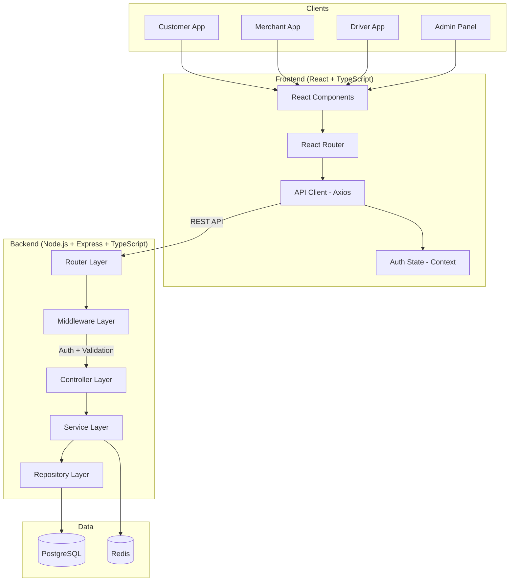
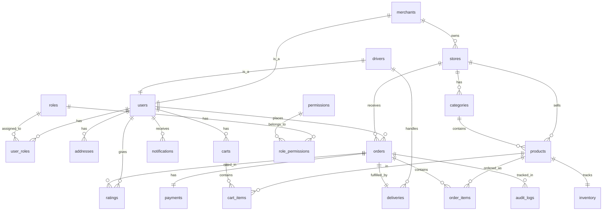
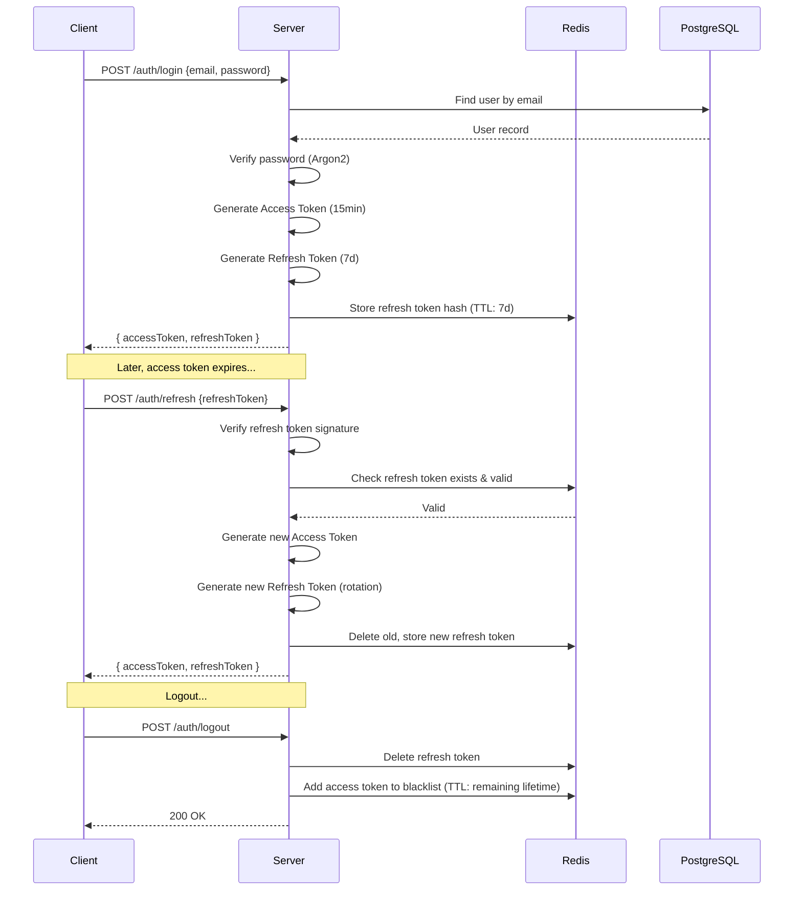
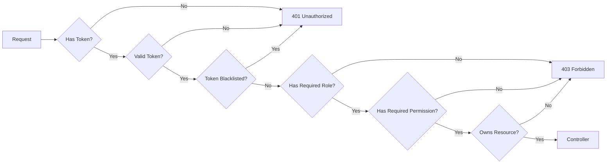
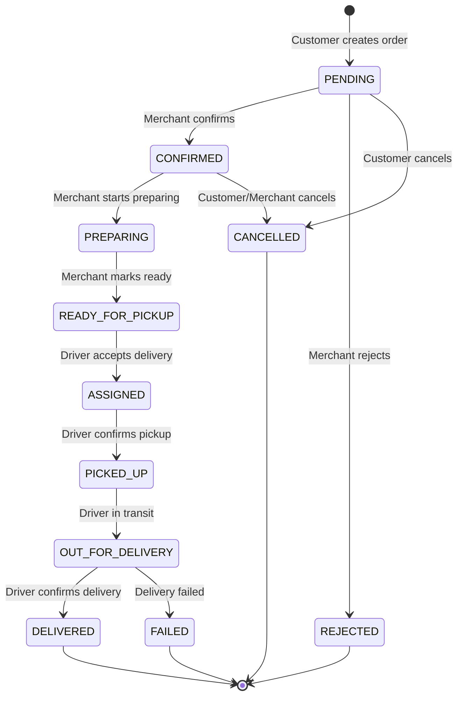
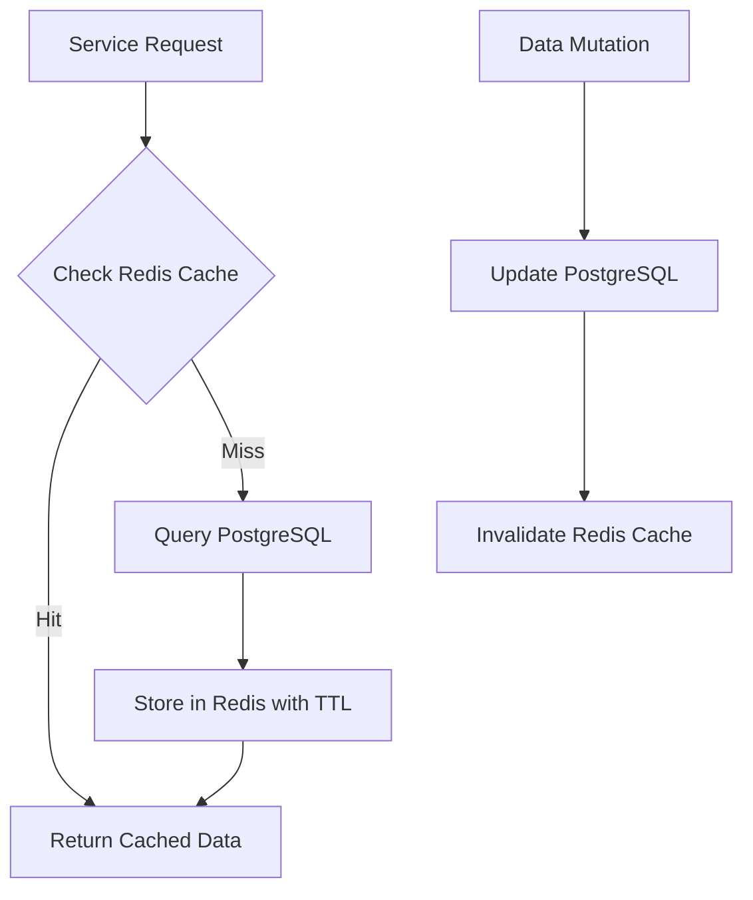
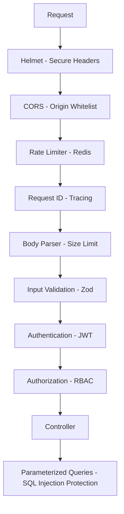

# Talbak — Delivery Platform Architecture & Design Document

> **Production-like Full-Stack Delivery Management Platform**
> Node.js · TypeScript · React · PostgreSQL · Redis · Docker

---

## Table of Contents

1. [System Overview](#1-system-overview)
2. [Technology Decisions & Trade-offs](#2-technology-decisions--trade-offs)
3. [Project Structure](#3-project-structure)
4. [Database Design](#4-database-design)
5. [REST API Design](#5-rest-api-design)
6. [Authentication & Authorization](#6-authentication--authorization)
7. [Order State Machine](#7-order-state-machine)
8. [Redis Strategy](#8-redis-strategy)
9. [Error Handling](#9-error-handling)
10. [Security](#10-security)
11. [Testing Strategy](#11-testing-strategy)
12. [Docker & Deployment](#12-docker--deployment)
13. [Phased Implementation Plan](#13-phased-implementation-plan)

---

## 1. System Overview



### Actors

| Actor | Description |
|-------|-------------|
| **Customer** | Browse stores, order products, track deliveries, rate experience |
| **Merchant** | Manage store/products/categories, handle incoming orders |
| **Driver** | Accept deliveries, update location/status, manage earnings |
| **Admin** | Full platform management, reports, audit logs |

---

## 2. Technology Decisions & Trade-offs

### Why PostgreSQL?

| Aspect | Decision |
|--------|----------|
| **What** | Primary relational database and source of truth |
| **Why** | ACID compliance for financial transactions (orders, payments). Rich indexing (B-tree, GIN for search). Complex JOINs for reporting. Strong data integrity via constraints/foreign keys |
| **Trade-off** | Slightly more overhead than NoSQL for simple key-value lookups — mitigated by Redis cache layer |
| **Alternative** | MongoDB — rejected because delivery platforms have highly relational data (users→orders→items→deliveries→drivers) |

### Why Redis?

| Aspect | Decision |
|--------|----------|
| **What** | In-memory cache, rate limiter, session store, temporary data |
| **Why** | Sub-millisecond reads for frequently accessed data (store listings, product catalogs). Built-in TTL for expiration. Atomic operations for rate limiting |
| **Trade-off** | Added infrastructure complexity. Data loss on crash (acceptable — Redis is cache, not source of truth) |
| **Alternative** | In-process cache (node-cache) — rejected because it doesn't scale across multiple Node instances |

### Why Express.js (not NestJS)?

| Aspect | Decision |
|--------|----------|
| **What** | Lightweight HTTP framework |
| **Why** | Maximum transparency — every layer (router, middleware, controller, service, repository) is explicitly visible. Easier to discuss architecture in interviews. No "magic" DI container |
| **Trade-off** | More boilerplate than NestJS. Manual DI setup required |
| **Alternative** | NestJS — rejected because it hides too much behind decorators, making architecture less visible for portfolio demonstration |

### Why JWT (not Sessions)?

| Aspect | Decision |
|--------|----------|
| **What** | Stateless authentication with access + refresh token pair |
| **Why** | Stateless — no server-side session storage needed for auth verification. Works well with REST APIs. Supports multiple clients. Access token (15min) + Refresh token (7d) pattern |
| **Trade-off** | Cannot instantly revoke access tokens (mitigated by short TTL + Redis blacklist for critical cases) |
| **Alternative** | Session-based auth — rejected because it requires sticky sessions or shared session store, adding complexity for a REST API |

### Why Modular Monolith?

| Aspect | Decision |
|--------|----------|
| **What** | Single deployable unit with clear module boundaries |
| **Why** | Simpler deployment, debugging, and transaction management. Clear domain boundaries allow future service extraction |
| **Trade-off** | All modules share the same process — a bug in one module can affect others |
| **When to extract** | When a module (e.g., notifications) needs independent scaling, different deployment cadence, or a separate team owns it |

### Why Argon2 (not bcrypt)?

| Aspect | Decision |
|--------|----------|
| **What** | Password hashing algorithm |
| **Why** | Winner of the Password Hashing Competition. Memory-hard — resistant to GPU/ASIC attacks. Configurable time/memory/parallelism cost |
| **Trade-off** | Slightly newer than bcrypt, less battle-tested in legacy systems |
| **Alternative** | bcrypt — acceptable fallback, but Argon2id is the current best practice |

---

## 3. Project Structure

```
talbak/
├── frontend/                          # React + TypeScript
│   ├── public/
│   ├── src/
│   │   ├── api/                       # API client, interceptors
│   │   │   ├── client.ts              # Axios instance + interceptors
│   │   │   ├── auth.api.ts
│   │   │   ├── stores.api.ts
│   │   │   ├── products.api.ts
│   │   │   ├── cart.api.ts
│   │   │   ├── orders.api.ts
│   │   │   ├── deliveries.api.ts
│   │   │   └── admin.api.ts
│   │   ├── components/                # Reusable UI components
│   │   │   ├── common/                # Button, Input, Modal, Table, Toast...
│   │   │   ├── layout/                # Header, Sidebar, Footer, Layout
│   │   │   ├── auth/                  # LoginForm, RegisterForm
│   │   │   ├── store/                 # StoreCard, StoreList
│   │   │   ├── product/               # ProductCard, ProductGrid
│   │   │   ├── cart/                   # CartItem, CartSummary
│   │   │   ├── order/                 # OrderCard, OrderTimeline, OrderStatus
│   │   │   └── dashboard/            # StatCard, Chart, RecentOrders
│   │   ├── contexts/                  # React Context providers
│   │   │   ├── AuthContext.tsx
│   │   │   ├── CartContext.tsx
│   │   │   └── NotificationContext.tsx
│   │   ├── hooks/                     # Custom hooks
│   │   │   ├── useAuth.ts
│   │   │   ├── useCart.ts
│   │   │   ├── usePagination.ts
│   │   │   └── useNotifications.ts
│   │   ├── pages/                     # Page components
│   │   │   ├── public/                # Home, Stores, StoreDetail, Login, Register
│   │   │   ├── customer/              # Dashboard, Cart, Checkout, Orders, Tracking
│   │   │   ├── merchant/              # Dashboard, Products, Categories, Orders
│   │   │   ├── driver/                # Dashboard, Available, ActiveDelivery, Earnings
│   │   │   ├── admin/                 # Dashboard, Users, Merchants, Drivers, Reports
│   │   │   └── AboutProject.tsx       # Portfolio / technical showcase page
│   │   ├── routes/                    # Route definitions + guards
│   │   │   ├── AppRouter.tsx
│   │   │   ├── ProtectedRoute.tsx
│   │   │   └── RoleRoute.tsx
│   │   ├── types/                     # TypeScript interfaces & types
│   │   ├── utils/                     # Helpers, formatters, validators
│   │   ├── styles/                    # Global CSS, design tokens
│   │   │   ├── globals.css
│   │   │   ├── variables.css
│   │   │   └── components/
│   │   ├── App.tsx
│   │   └── main.tsx
│   ├── package.json
│   ├── tsconfig.json
│   ├── vite.config.ts
│   └── Dockerfile
│
├── backend/                           # Node.js + Express + TypeScript
│   ├── src/
│   │   ├── modules/                   # Feature modules
│   │   │   ├── auth/
│   │   │   │   ├── auth.routes.ts
│   │   │   │   ├── auth.controller.ts
│   │   │   │   ├── auth.service.ts
│   │   │   │   ├── auth.repository.ts
│   │   │   │   ├── auth.validation.ts
│   │   │   │   └── auth.types.ts
│   │   │   ├── users/
│   │   │   │   ├── users.routes.ts
│   │   │   │   ├── users.controller.ts
│   │   │   │   ├── users.service.ts
│   │   │   │   ├── users.repository.ts
│   │   │   │   └── users.types.ts
│   │   │   ├── merchants/
│   │   │   ├── drivers/
│   │   │   ├── stores/
│   │   │   ├── products/
│   │   │   ├── categories/
│   │   │   ├── cart/
│   │   │   ├── orders/
│   │   │   │   ├── orders.routes.ts
│   │   │   │   ├── orders.controller.ts
│   │   │   │   ├── orders.service.ts
│   │   │   │   ├── orders.repository.ts
│   │   │   │   ├── orders.validation.ts
│   │   │   │   ├── orders.types.ts
│   │   │   │   └── order-state-machine.ts
│   │   │   ├── deliveries/
│   │   │   ├── payments/
│   │   │   ├── notifications/
│   │   │   ├── ratings/
│   │   │   └── reports/
│   │   ├── common/
│   │   │   ├── middleware/
│   │   │   │   ├── auth.middleware.ts
│   │   │   │   ├── rbac.middleware.ts
│   │   │   │   ├── validation.middleware.ts
│   │   │   │   ├── rate-limiter.middleware.ts
│   │   │   │   ├── request-id.middleware.ts
│   │   │   │   ├── error-handler.middleware.ts
│   │   │   │   └── logger.middleware.ts
│   │   │   ├── errors/
│   │   │   │   ├── AppError.ts
│   │   │   │   ├── ValidationError.ts
│   │   │   │   ├── AuthenticationError.ts
│   │   │   │   ├── AuthorizationError.ts
│   │   │   │   ├── NotFoundError.ts
│   │   │   │   ├── ConflictError.ts
│   │   │   │   ├── BusinessRuleError.ts
│   │   │   │   └── index.ts
│   │   │   ├── validation/
│   │   │   │   └── schemas.ts           # Zod schemas
│   │   │   ├── utils/
│   │   │   │   ├── logger.ts            # Structured logger (pino)
│   │   │   │   ├── pagination.ts
│   │   │   │   ├── response.ts          # Consistent API response helpers
│   │   │   │   └── idempotency.ts
│   │   │   └── constants/
│   │   │       ├── roles.ts
│   │   │       ├── order-statuses.ts
│   │   │       └── cache-keys.ts
│   │   ├── config/
│   │   │   ├── index.ts                 # Environment config loader
│   │   │   ├── database.ts
│   │   │   ├── redis.ts
│   │   │   └── swagger.ts
│   │   ├── database/
│   │   │   ├── migrations/
│   │   │   │   ├── 001_create_users.ts
│   │   │   │   ├── 002_create_roles.ts
│   │   │   │   ├── ...
│   │   │   └── seeds/
│   │   │       ├── 01_roles.ts
│   │   │       ├── 02_admin.ts
│   │   │       ├── 03_merchants.ts
│   │   │       ├── 04_stores.ts
│   │   │       ├── 05_categories.ts
│   │   │       ├── 06_products.ts
│   │   │       ├── 07_customers.ts
│   │   │       ├── 08_drivers.ts
│   │   │       └── 09_orders.ts
│   │   ├── redis/
│   │   │   ├── client.ts
│   │   │   └── cache.service.ts
│   │   └── app.ts                       # Express app bootstrap
│   ├── tests/
│   │   ├── unit/
│   │   │   ├── orders/
│   │   │   │   ├── order-service.test.ts
│   │   │   │   └── order-state-machine.test.ts
│   │   │   ├── auth/
│   │   │   │   └── auth-service.test.ts
│   │   │   └── cart/
│   │   │       └── cart-service.test.ts
│   │   ├── integration/
│   │   │   ├── auth.test.ts
│   │   │   ├── orders.test.ts
│   │   │   └── deliveries.test.ts
│   │   └── setup.ts
│   ├── package.json
│   ├── tsconfig.json
│   └── Dockerfile
│
├── docs/
│   ├── architecture.md
│   ├── api.md
│   ├── database.md
│   ├── redis.md
│   └── security.md
│
├── docker-compose.yml
├── .env.example
├── .gitignore
└── README.md
```

---

## 4. Database Design

### Entity Relationship Diagram



### Table Definitions

#### `users`
```sql
CREATE TABLE users (
    id              UUID PRIMARY KEY DEFAULT gen_random_uuid(),
    email           VARCHAR(255) NOT NULL UNIQUE,
    password_hash   VARCHAR(255) NOT NULL,
    first_name      VARCHAR(100) NOT NULL,
    last_name       VARCHAR(100) NOT NULL,
    phone           VARCHAR(20),
    avatar_url      VARCHAR(500),
    is_active       BOOLEAN NOT NULL DEFAULT true,
    email_verified  BOOLEAN NOT NULL DEFAULT false,
    last_login_at   TIMESTAMPTZ,
    created_at      TIMESTAMPTZ NOT NULL DEFAULT NOW(),
    updated_at      TIMESTAMPTZ NOT NULL DEFAULT NOW()
);

CREATE UNIQUE INDEX idx_users_email ON users(email);
-- Query pattern: Login lookup, unique constraint enforcement
```

#### `roles`
```sql
CREATE TABLE roles (
    id          UUID PRIMARY KEY DEFAULT gen_random_uuid(),
    name        VARCHAR(50) NOT NULL UNIQUE,  -- CUSTOMER, MERCHANT, DRIVER, ADMIN
    description VARCHAR(255),
    created_at  TIMESTAMPTZ NOT NULL DEFAULT NOW()
);

CREATE TABLE permissions (
    id          UUID PRIMARY KEY DEFAULT gen_random_uuid(),
    name        VARCHAR(100) NOT NULL UNIQUE,  -- e.g. 'orders:create', 'products:manage'
    description VARCHAR(255),
    created_at  TIMESTAMPTZ NOT NULL DEFAULT NOW()
);

CREATE TABLE role_permissions (
    role_id       UUID NOT NULL REFERENCES roles(id) ON DELETE CASCADE,
    permission_id UUID NOT NULL REFERENCES permissions(id) ON DELETE CASCADE,
    PRIMARY KEY (role_id, permission_id)
);

CREATE TABLE user_roles (
    user_id    UUID NOT NULL REFERENCES users(id) ON DELETE CASCADE,
    role_id    UUID NOT NULL REFERENCES roles(id) ON DELETE CASCADE,
    assigned_at TIMESTAMPTZ NOT NULL DEFAULT NOW(),
    PRIMARY KEY (user_id, role_id)
);

CREATE INDEX idx_user_roles_user ON user_roles(user_id);
-- Query pattern: Fetch all roles for a user during auth
```

#### `merchants`
```sql
CREATE TABLE merchants (
    id              UUID PRIMARY KEY DEFAULT gen_random_uuid(),
    user_id         UUID NOT NULL UNIQUE REFERENCES users(id) ON DELETE CASCADE,
    business_name   VARCHAR(255) NOT NULL,
    business_email  VARCHAR(255),
    business_phone  VARCHAR(20),
    tax_id          VARCHAR(50),
    status          VARCHAR(20) NOT NULL DEFAULT 'PENDING'
                    CHECK (status IN ('PENDING', 'APPROVED', 'SUSPENDED', 'REJECTED')),
    approved_at     TIMESTAMPTZ,
    created_at      TIMESTAMPTZ NOT NULL DEFAULT NOW(),
    updated_at      TIMESTAMPTZ NOT NULL DEFAULT NOW()
);

CREATE UNIQUE INDEX idx_merchants_user ON merchants(user_id);
```

#### `stores`
```sql
CREATE TABLE stores (
    id              UUID PRIMARY KEY DEFAULT gen_random_uuid(),
    merchant_id     UUID NOT NULL REFERENCES merchants(id) ON DELETE CASCADE,
    name            VARCHAR(255) NOT NULL,
    slug            VARCHAR(255) NOT NULL UNIQUE,
    description     TEXT,
    logo_url        VARCHAR(500),
    cover_url       VARCHAR(500),
    phone           VARCHAR(20),
    email           VARCHAR(255),
    address         TEXT,
    latitude        DECIMAL(10, 8),
    longitude       DECIMAL(11, 8),
    is_active       BOOLEAN NOT NULL DEFAULT true,
    opens_at        TIME,
    closes_at       TIME,
    min_order       DECIMAL(10, 2) DEFAULT 0,
    delivery_fee    DECIMAL(10, 2) DEFAULT 0,
    avg_rating      DECIMAL(3, 2) DEFAULT 0,
    total_ratings   INTEGER DEFAULT 0,
    created_at      TIMESTAMPTZ NOT NULL DEFAULT NOW(),
    updated_at      TIMESTAMPTZ NOT NULL DEFAULT NOW()
);

CREATE INDEX idx_stores_merchant ON stores(merchant_id);
CREATE INDEX idx_stores_active ON stores(is_active) WHERE is_active = true;
-- Query pattern: List active stores, merchant's stores
```

#### `drivers`
```sql
CREATE TABLE drivers (
    id                  UUID PRIMARY KEY DEFAULT gen_random_uuid(),
    user_id             UUID NOT NULL UNIQUE REFERENCES users(id) ON DELETE CASCADE,
    license_number      VARCHAR(50),
    vehicle_type        VARCHAR(50) CHECK (vehicle_type IN ('BICYCLE', 'MOTORCYCLE', 'CAR')),
    vehicle_plate       VARCHAR(20),
    status              VARCHAR(20) NOT NULL DEFAULT 'PENDING'
                        CHECK (status IN ('PENDING', 'APPROVED', 'SUSPENDED')),
    availability        VARCHAR(20) NOT NULL DEFAULT 'OFFLINE'
                        CHECK (availability IN ('ONLINE', 'OFFLINE', 'BUSY')),
    current_latitude    DECIMAL(10, 8),
    current_longitude   DECIMAL(11, 8),
    avg_rating          DECIMAL(3, 2) DEFAULT 0,
    total_deliveries    INTEGER DEFAULT 0,
    total_earnings      DECIMAL(12, 2) DEFAULT 0,
    created_at          TIMESTAMPTZ NOT NULL DEFAULT NOW(),
    updated_at          TIMESTAMPTZ NOT NULL DEFAULT NOW()
);

CREATE UNIQUE INDEX idx_drivers_user ON drivers(user_id);
CREATE INDEX idx_drivers_availability ON drivers(availability) WHERE availability = 'ONLINE';
-- Query pattern: Find available drivers for assignment
```

#### `categories`
```sql
CREATE TABLE categories (
    id          UUID PRIMARY KEY DEFAULT gen_random_uuid(),
    store_id    UUID NOT NULL REFERENCES stores(id) ON DELETE CASCADE,
    name        VARCHAR(100) NOT NULL,
    slug        VARCHAR(100) NOT NULL,
    description TEXT,
    sort_order  INTEGER DEFAULT 0,
    is_active   BOOLEAN NOT NULL DEFAULT true,
    created_at  TIMESTAMPTZ NOT NULL DEFAULT NOW(),
    updated_at  TIMESTAMPTZ NOT NULL DEFAULT NOW(),
    UNIQUE (store_id, slug)
);

CREATE INDEX idx_categories_store ON categories(store_id);
```

#### `products`
```sql
CREATE TABLE products (
    id              UUID PRIMARY KEY DEFAULT gen_random_uuid(),
    store_id        UUID NOT NULL REFERENCES stores(id) ON DELETE CASCADE,
    category_id     UUID REFERENCES categories(id) ON DELETE SET NULL,
    name            VARCHAR(255) NOT NULL,
    slug            VARCHAR(255) NOT NULL,
    description     TEXT,
    price           DECIMAL(10, 2) NOT NULL CHECK (price >= 0),
    compare_price   DECIMAL(10, 2) CHECK (compare_price >= 0),
    image_url       VARCHAR(500),
    is_active       BOOLEAN NOT NULL DEFAULT true,
    sort_order      INTEGER DEFAULT 0,
    created_at      TIMESTAMPTZ NOT NULL DEFAULT NOW(),
    updated_at      TIMESTAMPTZ NOT NULL DEFAULT NOW(),
    UNIQUE (store_id, slug)
);

CREATE INDEX idx_products_store ON products(store_id);
CREATE INDEX idx_products_category ON products(category_id);
CREATE INDEX idx_products_store_active ON products(store_id, is_active) WHERE is_active = true;
-- Query pattern: List products by store, filter by category, active products only
```

#### `inventory`
```sql
CREATE TABLE inventory (
    id          UUID PRIMARY KEY DEFAULT gen_random_uuid(),
    product_id  UUID NOT NULL UNIQUE REFERENCES products(id) ON DELETE CASCADE,
    quantity    INTEGER NOT NULL DEFAULT 0 CHECK (quantity >= 0),
    low_stock   INTEGER NOT NULL DEFAULT 5,
    updated_at  TIMESTAMPTZ NOT NULL DEFAULT NOW()
);

CREATE UNIQUE INDEX idx_inventory_product ON inventory(product_id);
```

#### `addresses`
```sql
CREATE TABLE addresses (
    id          UUID PRIMARY KEY DEFAULT gen_random_uuid(),
    user_id     UUID NOT NULL REFERENCES users(id) ON DELETE CASCADE,
    label       VARCHAR(50) NOT NULL DEFAULT 'Home',
    address_line VARCHAR(500) NOT NULL,
    city        VARCHAR(100),
    area        VARCHAR(100),
    latitude    DECIMAL(10, 8),
    longitude   DECIMAL(11, 8),
    is_default  BOOLEAN NOT NULL DEFAULT false,
    created_at  TIMESTAMPTZ NOT NULL DEFAULT NOW(),
    updated_at  TIMESTAMPTZ NOT NULL DEFAULT NOW()
);

CREATE INDEX idx_addresses_user ON addresses(user_id);
-- Query pattern: Get user's addresses for checkout
```

#### `carts`
```sql
CREATE TABLE carts (
    id          UUID PRIMARY KEY DEFAULT gen_random_uuid(),
    user_id     UUID NOT NULL UNIQUE REFERENCES users(id) ON DELETE CASCADE,
    store_id    UUID REFERENCES stores(id) ON DELETE SET NULL,
    created_at  TIMESTAMPTZ NOT NULL DEFAULT NOW(),
    updated_at  TIMESTAMPTZ NOT NULL DEFAULT NOW()
);

CREATE UNIQUE INDEX idx_carts_user ON carts(user_id);
-- One active cart per user

CREATE TABLE cart_items (
    id          UUID PRIMARY KEY DEFAULT gen_random_uuid(),
    cart_id     UUID NOT NULL REFERENCES carts(id) ON DELETE CASCADE,
    product_id  UUID NOT NULL REFERENCES products(id) ON DELETE CASCADE,
    quantity    INTEGER NOT NULL DEFAULT 1 CHECK (quantity > 0),
    created_at  TIMESTAMPTZ NOT NULL DEFAULT NOW(),
    updated_at  TIMESTAMPTZ NOT NULL DEFAULT NOW(),
    UNIQUE (cart_id, product_id)
);

CREATE INDEX idx_cart_items_cart ON cart_items(cart_id);
```

#### `orders`
```sql
CREATE TABLE orders (
    id                  UUID PRIMARY KEY DEFAULT gen_random_uuid(),
    order_number        VARCHAR(20) NOT NULL UNIQUE,  -- Human-readable: TLB-20260930-0001
    user_id             UUID NOT NULL REFERENCES users(id),
    store_id            UUID NOT NULL REFERENCES stores(id),
    address_id          UUID REFERENCES addresses(id),
    status              VARCHAR(30) NOT NULL DEFAULT 'PENDING'
                        CHECK (status IN (
                            'PENDING', 'CONFIRMED', 'PREPARING',
                            'READY_FOR_PICKUP', 'ASSIGNED', 'PICKED_UP',
                            'OUT_FOR_DELIVERY', 'DELIVERED',
                            'CANCELLED', 'REJECTED', 'FAILED'
                        )),
    subtotal            DECIMAL(10, 2) NOT NULL,
    delivery_fee        DECIMAL(10, 2) NOT NULL DEFAULT 0,
    tax                 DECIMAL(10, 2) NOT NULL DEFAULT 0,
    total               DECIMAL(10, 2) NOT NULL,
    notes               TEXT,
    cancelled_by        VARCHAR(20) CHECK (cancelled_by IN ('CUSTOMER', 'MERCHANT', 'ADMIN', 'SYSTEM')),
    cancel_reason       TEXT,
    idempotency_key     VARCHAR(255) UNIQUE,  -- Prevent duplicate orders
    confirmed_at        TIMESTAMPTZ,
    preparing_at        TIMESTAMPTZ,
    ready_at            TIMESTAMPTZ,
    picked_up_at        TIMESTAMPTZ,
    delivered_at        TIMESTAMPTZ,
    cancelled_at        TIMESTAMPTZ,
    created_at          TIMESTAMPTZ NOT NULL DEFAULT NOW(),
    updated_at          TIMESTAMPTZ NOT NULL DEFAULT NOW()
);

CREATE INDEX idx_orders_user ON orders(user_id);
CREATE INDEX idx_orders_store ON orders(store_id);
CREATE INDEX idx_orders_status ON orders(status);
CREATE INDEX idx_orders_created ON orders(created_at DESC);
CREATE INDEX idx_orders_user_status ON orders(user_id, status);
-- Query patterns: User's orders, store's orders, filter by status, recent orders
```

#### `order_items`
```sql
CREATE TABLE order_items (
    id              UUID PRIMARY KEY DEFAULT gen_random_uuid(),
    order_id        UUID NOT NULL REFERENCES orders(id) ON DELETE CASCADE,
    product_id      UUID NOT NULL REFERENCES products(id),
    product_name    VARCHAR(255) NOT NULL,  -- Snapshot at order time
    product_price   DECIMAL(10, 2) NOT NULL,  -- Snapshot at order time
    quantity        INTEGER NOT NULL CHECK (quantity > 0),
    total           DECIMAL(10, 2) NOT NULL,
    created_at      TIMESTAMPTZ NOT NULL DEFAULT NOW()
);

CREATE INDEX idx_order_items_order ON order_items(order_id);
```

> [!IMPORTANT]
> `product_name` and `product_price` are snapshotted at order creation time. This ensures order history remains accurate even if the merchant later changes product details.

#### `deliveries`
```sql
CREATE TABLE deliveries (
    id                  UUID PRIMARY KEY DEFAULT gen_random_uuid(),
    order_id            UUID NOT NULL UNIQUE REFERENCES orders(id),
    driver_id           UUID REFERENCES drivers(id),
    status              VARCHAR(30) NOT NULL DEFAULT 'PENDING'
                        CHECK (status IN (
                            'PENDING', 'ASSIGNED', 'PICKED_UP',
                            'IN_TRANSIT', 'DELIVERED', 'FAILED'
                        )),
    pickup_latitude     DECIMAL(10, 8),
    pickup_longitude    DECIMAL(11, 8),
    dropoff_latitude    DECIMAL(10, 8),
    dropoff_longitude   DECIMAL(11, 8),
    current_latitude    DECIMAL(10, 8),
    current_longitude   DECIMAL(11, 8),
    distance_km         DECIMAL(8, 2),
    estimated_time_min  INTEGER,
    delivery_fee        DECIMAL(10, 2) NOT NULL DEFAULT 0,
    assigned_at         TIMESTAMPTZ,
    picked_up_at        TIMESTAMPTZ,
    delivered_at        TIMESTAMPTZ,
    created_at          TIMESTAMPTZ NOT NULL DEFAULT NOW(),
    updated_at          TIMESTAMPTZ NOT NULL DEFAULT NOW()
);

CREATE UNIQUE INDEX idx_deliveries_order ON deliveries(order_id);
CREATE INDEX idx_deliveries_driver ON deliveries(driver_id);
CREATE INDEX idx_deliveries_status ON deliveries(status);
CREATE INDEX idx_deliveries_driver_status ON deliveries(driver_id, status);
-- Query patterns: Driver's active delivery, pending deliveries for assignment
```

#### `payments`
```sql
CREATE TABLE payments (
    id              UUID PRIMARY KEY DEFAULT gen_random_uuid(),
    order_id        UUID NOT NULL UNIQUE REFERENCES orders(id),
    amount          DECIMAL(10, 2) NOT NULL,
    method          VARCHAR(30) NOT NULL DEFAULT 'CASH'
                    CHECK (method IN ('CASH', 'CARD', 'WALLET')),
    status          VARCHAR(20) NOT NULL DEFAULT 'PENDING'
                    CHECK (status IN ('PENDING', 'SUCCESS', 'FAILED', 'REFUNDED')),
    transaction_id  VARCHAR(255),  -- From payment gateway (mock)
    paid_at         TIMESTAMPTZ,
    created_at      TIMESTAMPTZ NOT NULL DEFAULT NOW(),
    updated_at      TIMESTAMPTZ NOT NULL DEFAULT NOW()
);

CREATE UNIQUE INDEX idx_payments_order ON payments(order_id);
```

#### `notifications`
```sql
CREATE TABLE notifications (
    id          UUID PRIMARY KEY DEFAULT gen_random_uuid(),
    user_id     UUID NOT NULL REFERENCES users(id) ON DELETE CASCADE,
    type        VARCHAR(50) NOT NULL,  -- ORDER_CONFIRMED, DRIVER_ASSIGNED, etc.
    title       VARCHAR(255) NOT NULL,
    message     TEXT NOT NULL,
    data        JSONB,  -- { orderId, deliveryId, etc. }
    is_read     BOOLEAN NOT NULL DEFAULT false,
    created_at  TIMESTAMPTZ NOT NULL DEFAULT NOW()
);

CREATE INDEX idx_notifications_user ON notifications(user_id);
CREATE INDEX idx_notifications_user_unread ON notifications(user_id, is_read) WHERE is_read = false;
-- Query pattern: User's unread notifications
```

#### `ratings`
```sql
CREATE TABLE ratings (
    id          UUID PRIMARY KEY DEFAULT gen_random_uuid(),
    order_id    UUID NOT NULL REFERENCES orders(id),
    user_id     UUID NOT NULL REFERENCES users(id),
    target_type VARCHAR(20) NOT NULL CHECK (target_type IN ('STORE', 'DRIVER', 'ORDER')),
    target_id   UUID NOT NULL,
    score       INTEGER NOT NULL CHECK (score >= 1 AND score <= 5),
    comment     TEXT,
    created_at  TIMESTAMPTZ NOT NULL DEFAULT NOW(),
    UNIQUE (order_id, user_id, target_type)
);

CREATE INDEX idx_ratings_target ON ratings(target_type, target_id);
```

#### `audit_logs`
```sql
CREATE TABLE audit_logs (
    id          UUID PRIMARY KEY DEFAULT gen_random_uuid(),
    user_id     UUID REFERENCES users(id),
    action      VARCHAR(100) NOT NULL,  -- e.g. 'ORDER_CREATED', 'ORDER_STATUS_CHANGED'
    entity_type VARCHAR(50) NOT NULL,   -- e.g. 'order', 'product'
    entity_id   UUID,
    old_data    JSONB,
    new_data    JSONB,
    ip_address  VARCHAR(45),
    user_agent  TEXT,
    created_at  TIMESTAMPTZ NOT NULL DEFAULT NOW()
);

CREATE INDEX idx_audit_logs_user ON audit_logs(user_id);
CREATE INDEX idx_audit_logs_entity ON audit_logs(entity_type, entity_id);
CREATE INDEX idx_audit_logs_action ON audit_logs(action);
CREATE INDEX idx_audit_logs_created ON audit_logs(created_at DESC);
-- Query patterns: Admin audit trail, entity history, user activity
```

### Index Justification Summary

| Index | Query Pattern | Expected Benefit |
|-------|--------------|-----------------|
| `idx_users_email` | Login by email | O(log n) lookup instead of seq scan |
| `idx_orders_user_status` | Customer's pending/active orders | Composite avoids double lookup |
| `idx_orders_created` | Recent orders listing | DESC for latest-first pagination |
| `idx_deliveries_driver_status` | Driver's active deliveries | Composite for filtered dashboard |
| `idx_drivers_availability` | Find online drivers | Partial index reduces index size |
| `idx_stores_active` | List active stores | Partial index, skip inactive |
| `idx_products_store_active` | Store's active products | Composite for storefront queries |
| `idx_notifications_user_unread` | Unread notification count | Partial index, tiny for reads |

---

## 5. REST API Design

### Versioning

All endpoints prefixed with `/api/v1/`.

### Response Format

**Success:**
```json
{
  "success": true,
  "data": { ... },
  "meta": {
    "page": 1,
    "limit": 20,
    "total": 156,
    "totalPages": 8
  }
}
```

**Error:**
```json
{
  "success": false,
  "error": {
    "code": "ORDER_NOT_FOUND",
    "message": "Order with the specified ID was not found",
    "details": []
  }
}
```

### Endpoints

#### Auth Module
| Method | Endpoint | Auth | Description |
|--------|----------|------|-------------|
| `POST` | `/api/v1/auth/register` | ✗ | Register new user |
| `POST` | `/api/v1/auth/login` | ✗ | Login, returns access + refresh tokens |
| `POST` | `/api/v1/auth/refresh` | ✗ | Refresh access token |
| `POST` | `/api/v1/auth/logout` | ✓ | Logout, invalidate refresh token |
| `GET` | `/api/v1/auth/me` | ✓ | Get current user profile |

#### Users Module
| Method | Endpoint | Auth | Role | Description |
|--------|----------|------|------|-------------|
| `GET` | `/api/v1/users/profile` | ✓ | Any | Get own profile |
| `PATCH` | `/api/v1/users/profile` | ✓ | Any | Update own profile |
| `PATCH` | `/api/v1/users/password` | ✓ | Any | Change password |

#### Addresses Module
| Method | Endpoint | Auth | Description |
|--------|----------|------|-------------|
| `GET` | `/api/v1/addresses` | ✓ | List user's addresses |
| `POST` | `/api/v1/addresses` | ✓ | Add new address |
| `PATCH` | `/api/v1/addresses/:id` | ✓ | Update address |
| `DELETE` | `/api/v1/addresses/:id` | ✓ | Delete address |
| `PATCH` | `/api/v1/addresses/:id/default` | ✓ | Set as default |

#### Stores Module
| Method | Endpoint | Auth | Role | Description |
|--------|----------|------|------|-------------|
| `GET` | `/api/v1/stores` | ✗ | — | List active stores (paginated, searchable) |
| `GET` | `/api/v1/stores/:id` | ✗ | — | Store details + categories |
| `POST` | `/api/v1/stores` | ✓ | Merchant | Create store |
| `PATCH` | `/api/v1/stores/:id` | ✓ | Merchant (owner) | Update store |
| `GET` | `/api/v1/stores/:id/products` | ✗ | — | Store's products (paginated) |

#### Products Module
| Method | Endpoint | Auth | Role | Description |
|--------|----------|------|------|-------------|
| `GET` | `/api/v1/products` | ✗ | — | Search/filter all products |
| `GET` | `/api/v1/products/:id` | ✗ | — | Product details |
| `POST` | `/api/v1/products` | ✓ | Merchant | Create product |
| `PATCH` | `/api/v1/products/:id` | ✓ | Merchant (owner) | Update product |
| `DELETE` | `/api/v1/products/:id` | ✓ | Merchant (owner) | Soft delete product |

#### Categories Module
| Method | Endpoint | Auth | Role | Description |
|--------|----------|------|------|-------------|
| `GET` | `/api/v1/stores/:storeId/categories` | ✗ | — | List store categories |
| `POST` | `/api/v1/categories` | ✓ | Merchant | Create category |
| `PATCH` | `/api/v1/categories/:id` | ✓ | Merchant (owner) | Update category |
| `DELETE` | `/api/v1/categories/:id` | ✓ | Merchant (owner) | Delete category |

#### Cart Module
| Method | Endpoint | Auth | Description |
|--------|----------|------|-------------|
| `GET` | `/api/v1/cart` | ✓ | Get current cart |
| `POST` | `/api/v1/cart/items` | ✓ | Add item to cart |
| `PATCH` | `/api/v1/cart/items/:id` | ✓ | Update item quantity |
| `DELETE` | `/api/v1/cart/items/:id` | ✓ | Remove item from cart |
| `DELETE` | `/api/v1/cart` | ✓ | Clear cart |

> [!NOTE]
> Cart is locked to a single store. Adding a product from a different store prompts the user to clear the current cart first.

#### Orders Module
| Method | Endpoint | Auth | Role | Description |
|--------|----------|------|------|-------------|
| `POST` | `/api/v1/orders` | ✓ | Customer | Create order from cart |
| `GET` | `/api/v1/orders` | ✓ | Any | List own orders (filtered) |
| `GET` | `/api/v1/orders/:id` | ✓ | Any | Order details |
| `POST` | `/api/v1/orders/:id/cancel` | ✓ | Customer | Cancel order (business rules) |
| `POST` | `/api/v1/orders/:id/confirm` | ✓ | Merchant | Confirm order |
| `POST` | `/api/v1/orders/:id/reject` | ✓ | Merchant | Reject order |
| `PATCH` | `/api/v1/orders/:id/status` | ✓ | Merchant | Update preparation status |

#### Deliveries Module
| Method | Endpoint | Auth | Role | Description |
|--------|----------|------|------|-------------|
| `GET` | `/api/v1/deliveries/available` | ✓ | Driver | List available deliveries |
| `POST` | `/api/v1/deliveries/:id/accept` | ✓ | Driver | Accept delivery |
| `POST` | `/api/v1/deliveries/:id/pickup` | ✓ | Driver | Confirm pickup |
| `PATCH` | `/api/v1/deliveries/:id/status` | ✓ | Driver | Update delivery status |
| `PATCH` | `/api/v1/deliveries/:id/location` | ✓ | Driver | Update driver location |
| `POST` | `/api/v1/deliveries/:id/complete` | ✓ | Driver | Confirm delivery |
| `GET` | `/api/v1/deliveries/history` | ✓ | Driver | Delivery history |
| `GET` | `/api/v1/deliveries/earnings` | ✓ | Driver | Earnings summary |

#### Drivers Module
| Method | Endpoint | Auth | Role | Description |
|--------|----------|------|------|-------------|
| `PATCH` | `/api/v1/drivers/availability` | ✓ | Driver | Toggle online/offline |
| `GET` | `/api/v1/drivers/profile` | ✓ | Driver | Get driver profile |
| `PATCH` | `/api/v1/drivers/profile` | ✓ | Driver | Update driver profile |

#### Merchants Module
| Method | Endpoint | Auth | Role | Description |
|--------|----------|------|------|-------------|
| `GET` | `/api/v1/merchants/dashboard` | ✓ | Merchant | Dashboard stats |
| `GET` | `/api/v1/merchants/orders` | ✓ | Merchant | Merchant's orders |
| `GET` | `/api/v1/merchants/sales` | ✓ | Merchant | Sales summary |

#### Ratings Module
| Method | Endpoint | Auth | Description |
|--------|----------|------|-------------|
| `POST` | `/api/v1/ratings` | ✓ | Rate order/store/driver |
| `GET` | `/api/v1/ratings/store/:storeId` | ✗ | Store ratings |

#### Notifications Module
| Method | Endpoint | Auth | Description |
|--------|----------|------|-------------|
| `GET` | `/api/v1/notifications` | ✓ | List user's notifications |
| `PATCH` | `/api/v1/notifications/:id/read` | ✓ | Mark as read |
| `PATCH` | `/api/v1/notifications/read-all` | ✓ | Mark all as read |
| `GET` | `/api/v1/notifications/unread-count` | ✓ | Unread count |

#### Admin Module
| Method | Endpoint | Auth | Role | Description |
|--------|----------|------|------|-------------|
| `GET` | `/api/v1/admin/dashboard` | ✓ | Admin | Dashboard stats |
| `GET` | `/api/v1/admin/users` | ✓ | Admin | List all users |
| `PATCH` | `/api/v1/admin/users/:id/status` | ✓ | Admin | Activate/suspend user |
| `GET` | `/api/v1/admin/merchants` | ✓ | Admin | List merchants |
| `PATCH` | `/api/v1/admin/merchants/:id/status` | ✓ | Admin | Approve/suspend merchant |
| `GET` | `/api/v1/admin/drivers` | ✓ | Admin | List drivers |
| `PATCH` | `/api/v1/admin/drivers/:id/status` | ✓ | Admin | Approve/suspend driver |
| `GET` | `/api/v1/admin/orders` | ✓ | Admin | List all orders |
| `GET` | `/api/v1/admin/reports` | ✓ | Admin | Reports & analytics |
| `GET` | `/api/v1/admin/audit-logs` | ✓ | Admin | Audit logs |

---

## 6. Authentication & Authorization

### Authentication Flow



### Token Structure

**Access Token (JWT):**
```json
{
  "sub": "user-uuid",
  "email": "user@example.com",
  "roles": ["CUSTOMER"],
  "iat": 1696000000,
  "exp": 1696000900
}
```

### RBAC Middleware Flow



### Resource Ownership

Beyond role checking, resource-level authorization ensures:
- Merchants can only manage **their own** stores/products
- Customers can only access **their own** orders/cart
- Drivers can only update **their assigned** deliveries

---

## 7. Order State Machine

### Valid Transitions



### Transition Rules (Implementation)

```typescript
const VALID_TRANSITIONS: Record<OrderStatus, OrderStatus[]> = {
  PENDING:            ['CONFIRMED', 'REJECTED', 'CANCELLED'],
  CONFIRMED:          ['PREPARING', 'CANCELLED'],
  PREPARING:          ['READY_FOR_PICKUP'],
  READY_FOR_PICKUP:   ['ASSIGNED'],
  ASSIGNED:           ['PICKED_UP'],
  PICKED_UP:          ['OUT_FOR_DELIVERY'],
  OUT_FOR_DELIVERY:   ['DELIVERED', 'FAILED'],
  DELIVERED:          [],
  REJECTED:           [],
  CANCELLED:          [],
  FAILED:             [],
};
```

### Cancellation Business Rules

| Current Status | Can Customer Cancel? | Can Merchant Cancel? | Can Admin Cancel? |
|---------------|---------------------|---------------------|-------------------|
| PENDING | ✓ | ✓ | ✓ |
| CONFIRMED | ✓ (with possible fee) | ✓ | ✓ |
| PREPARING | ✗ | ✗ | ✓ |
| READY_FOR_PICKUP+ | ✗ | ✗ | ✓ |

---

## 8. Redis Strategy

### Cache-Aside Pattern



### Cache Key Conventions

| Key Pattern | TTL | Description |
|-------------|-----|-------------|
| `stores:list:page:{n}` | 5 min | Paginated store listings |
| `store:{id}` | 10 min | Single store details |
| `products:store:{storeId}:page:{n}` | 5 min | Store's products |
| `product:{id}` | 10 min | Single product |
| `user:{id}:notifications:count` | 1 min | Unread notification count |

### Rate Limiting

| Endpoint | Limit | Window | Key Pattern |
|----------|-------|--------|-------------|
| `POST /auth/login` | 5 attempts | 1 minute | `ratelimit:login:{ip}` |
| `POST /auth/register` | 3 attempts | 5 minutes | `ratelimit:register:{ip}` |
| General API | 100 requests | 1 minute | `ratelimit:api:{userId}` |

### Token Management

| Key Pattern | TTL | Description |
|-------------|-----|-------------|
| `refresh:{userId}:{tokenId}` | 7 days | Active refresh token hash |
| `blacklist:access:{tokenId}` | Remaining token TTL | Revoked access tokens |

### Temporary Data

| Key Pattern | TTL | Description |
|-------------|-----|-------------|
| `idempotency:{key}` | 24 hours | Idempotency key for duplicate prevention |
| `otp:{userId}` | 5 minutes | Email verification OTP |
| `checkout:{userId}` | 30 minutes | Temporary checkout state |

### Redis Failure Fallback

```typescript
// cache.service.ts - Graceful degradation
async get<T>(key: string): Promise<T | null> {
  try {
    const cached = await this.redis.get(key);
    return cached ? JSON.parse(cached) : null;
  } catch (error) {
    logger.warn({ key, error }, 'Redis read failed, falling back to DB');
    return null; // Caller proceeds to PostgreSQL
  }
}
```

> [!IMPORTANT]
> Redis is used **only as a cache**, never as the source of truth. If Redis is unavailable, the system degrades gracefully by hitting PostgreSQL directly. Rate limiting falls back to in-memory counters with a warning log.

---

## 9. Error Handling

### Error Class Hierarchy

```
AppError (base)
├── ValidationError        (400)
├── AuthenticationError     (401)
├── AuthorizationError      (403)
├── NotFoundError           (404)
├── ConflictError           (409)
├── BusinessRuleError       (422)
└── DatabaseError           (500 — internal, never exposed)
```

### Centralized Error Handler

```typescript
// error-handler.middleware.ts
function errorHandler(err: Error, req: Request, res: Response, next: NextFunction) {
  if (err instanceof AppError) {
    return res.status(err.statusCode).json({
      success: false,
      error: {
        code: err.errorCode,
        message: err.message,
        details: err.details || [],
      },
    });
  }

  // Unknown errors — log full details, return generic message
  logger.error({ err, requestId: req.id }, 'Unhandled error');
  return res.status(500).json({
    success: false,
    error: {
      code: 'INTERNAL_ERROR',
      message: 'An unexpected error occurred',
    },
  });
}
```

### Error Codes

| Code | HTTP | Description |
|------|------|-------------|
| `VALIDATION_ERROR` | 400 | Invalid request body/params |
| `INVALID_CREDENTIALS` | 401 | Wrong email/password |
| `TOKEN_EXPIRED` | 401 | Access token expired |
| `TOKEN_INVALID` | 401 | Malformed or tampered token |
| `INSUFFICIENT_PERMISSIONS` | 403 | Role lacks required permission |
| `RESOURCE_NOT_OWNED` | 403 | User doesn't own this resource |
| `ORDER_NOT_FOUND` | 404 | Order ID doesn't exist |
| `STORE_NOT_FOUND` | 404 | Store ID doesn't exist |
| `DUPLICATE_EMAIL` | 409 | Email already registered |
| `IDEMPOTENCY_CONFLICT` | 409 | Request with this key already processed |
| `INVALID_STATUS_TRANSITION` | 422 | Order can't transition to this status |
| `INSUFFICIENT_INVENTORY` | 422 | Product out of stock |
| `CART_STORE_MISMATCH` | 422 | Can't add products from different stores |
| `ORDER_CANCEL_FORBIDDEN` | 422 | Order can't be cancelled at this stage |
| `INTERNAL_ERROR` | 500 | Generic fallback (no details exposed) |

---

## 10. Security

### Security Layers



### Security Checklist

| Measure | Implementation |
|---------|---------------|
| Password Hashing | Argon2id with tuned cost parameters |
| SQL Injection | Parameterized queries (pg library, never string concatenation) |
| XSS | Helmet headers, React auto-escapes by default |
| CSRF | Token-based auth (not cookies), SameSite |
| CORS | Whitelist frontend origin only |
| Rate Limiting | Redis-backed, per-IP and per-user |
| Input Validation | Zod schemas on all inputs |
| Secrets | `.env` files, never committed |
| Error Exposure | Strip stack traces and internal details in production |
| Secure Headers | Helmet middleware |
| Token Storage | httpOnly cookies for refresh token (or secure localStorage strategy) |

---

## 11. Testing Strategy

### Test Pyramid

| Level | Tool | Coverage Target |
|-------|------|-----------------|
| **Unit Tests** | Vitest | Business logic in services, state machine |
| **Integration Tests** | Vitest + Supertest + testcontainers | API endpoints with real DB |
| **E2E Smoke** | Supertest | Critical user flows |

### Priority Test Cases

**Unit Tests:**
- Order state machine — all valid/invalid transitions
- Cart service — add, update, remove, store mismatch validation
- Auth service — token generation, verification, password hashing
- Payment service — success/failure scenarios, idempotency

**Integration Tests:**
- Auth flow — register → login → access protected route → refresh → logout
- Order flow — create order → confirm → prepare → ready → assign → pickup → deliver
- Cart flow — add items → checkout → order creation (with inventory deduction)
- Delivery assignment — driver acceptance with concurrency handling

---

## 12. Docker & Deployment

### Docker Compose Architecture

```yaml
services:
  frontend:     # React dev server (Vite)  — port 3000
  backend:      # Node.js Express          — port 5000
  postgres:     # PostgreSQL 16            — port 5432
  redis:        # Redis 7                  — port 6379
```

### Dockerfile Strategy

- **Backend**: Multi-stage build (build TypeScript → slim Node runtime)
- **Frontend**: Multi-stage build (build Vite → nginx serve)
- **Dev mode**: Volume mounts for hot reload

---

## 13. Phased Implementation Plan

### Phase 1 — Foundation (Backend Core)
> Estimated: ~3-4 sessions

- [ ] Project setup (TypeScript, Express, folder structure, linting)
- [ ] Database connection (pg pool, config)
- [ ] Redis connection (ioredis, config)
- [ ] Migration system setup
- [ ] Core migrations (users, roles, permissions, user_roles)
- [ ] Error handling system (AppError hierarchy, centralized handler)
- [ ] Structured logging (pino)
- [ ] Request ID middleware
- [ ] Response helpers (success/error formatters)
- [ ] Environment config (.env, validation)
- [ ] Auth module (register, login, refresh, logout)
- [ ] JWT middleware
- [ ] RBAC middleware
- [ ] Rate limiting middleware
- [ ] Docker Compose (postgres + redis)

### Phase 2 — Domain Modules (Backend)
> Estimated: ~4-5 sessions

- [ ] Merchants module + migrations
- [ ] Stores module + migrations
- [ ] Categories module + migrations
- [ ] Products module + migrations + inventory
- [ ] Addresses module + migrations
- [ ] Cart module + migrations
- [ ] Redis caching (stores, products)
- [ ] Search/filter/pagination utilities
- [ ] Input validation (Zod schemas)

### Phase 3 — Order System (Backend)
> Estimated: ~3-4 sessions

- [ ] Orders module + migrations
- [ ] Order state machine
- [ ] Order creation (transaction: validate → calculate → create → inventory)
- [ ] Idempotency support
- [ ] Payment module (mock)
- [ ] Deliveries module + migrations
- [ ] Driver assignment logic
- [ ] Delivery status updates + location
- [ ] Notifications module + migrations
- [ ] Ratings module + migrations

### Phase 4 — Admin & Reports (Backend)
> Estimated: ~2 sessions

- [ ] Admin module (CRUD for all entities)
- [ ] Reports & analytics endpoints
- [ ] Audit logging
- [ ] Swagger/OpenAPI documentation

### Phase 5 — Frontend Foundation
> Estimated: ~3 sessions

- [ ] Vite + React + TypeScript setup
- [ ] Design system (CSS variables, global styles, typography)
- [ ] Reusable components (Button, Input, Modal, Table, Toast, Skeleton)
- [ ] Layout components (Header, Sidebar, Footer)
- [ ] API client (Axios + interceptors + token refresh)
- [ ] Auth context + protected routes
- [ ] Role-based route guards
- [ ] Public pages (Home, Stores, Store Detail, Login, Register)

### Phase 6 — Frontend Features
> Estimated: ~4-5 sessions

- [ ] Customer pages (Dashboard, Cart, Checkout, Orders, Tracking, Profile)
- [ ] Merchant pages (Dashboard, Products, Categories, Orders, Sales)
- [ ] Driver pages (Dashboard, Available, Active Delivery, History, Earnings)
- [ ] Admin pages (Dashboard, Users, Merchants, Drivers, Orders, Reports, Audit)
- [ ] Notification center
- [ ] About Project page (portfolio showcase)

### Phase 7 — Testing & Polish
> Estimated: ~2-3 sessions

- [ ] Unit tests (services, state machine)
- [ ] Integration tests (critical API flows)
- [ ] UX polish (loading, empty, error states, animations)
- [ ] Responsive design audit
- [ ] Docker production builds
- [ ] Seed data script

### Phase 8 — Documentation & Deployment
> Estimated: ~1-2 sessions

- [ ] README.md (comprehensive)
- [ ] docs/ folder (architecture, API, database, redis, security)
- [ ] `.env.example`
- [ ] `.gitignore`
- [ ] Demo accounts documentation
- [ ] Final Docker Compose validation
- [ ] Git commit history cleanup

---

> [!TIP]
> **Total estimated: ~22-26 sessions**. Each phase builds on the previous one and is independently testable. We'll validate each phase before moving to the next.

---

### Demo Accounts (Seed Data)

| Role | Email | Password |
|------|-------|----------|
| Admin | admin@talbak.com | Demo@1234 |
| Merchant | merchant@talbak.com | Demo@1234 |
| Driver | driver@talbak.com | Demo@1234 |
| Customer | customer@talbak.com | Demo@1234 |
